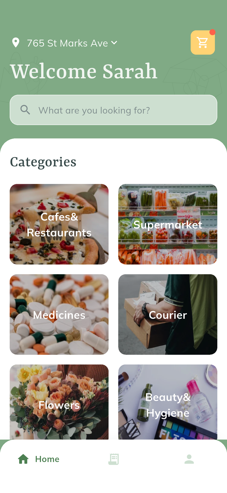
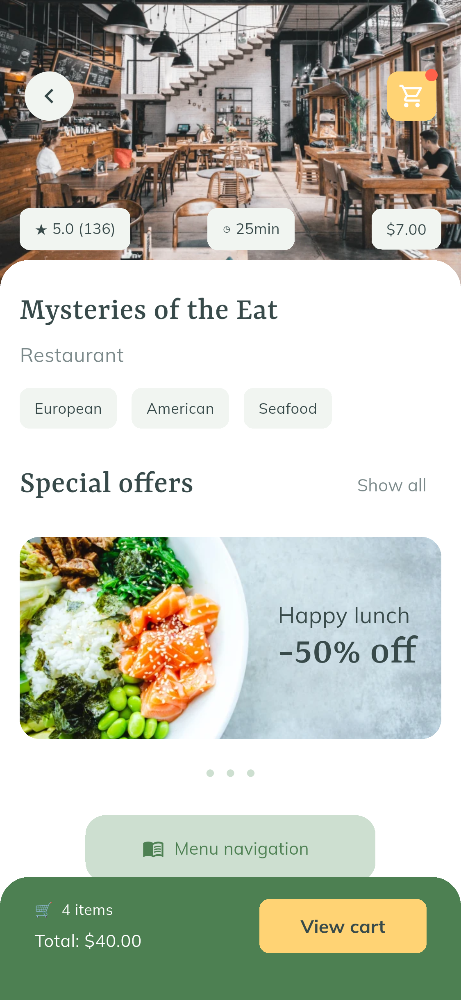
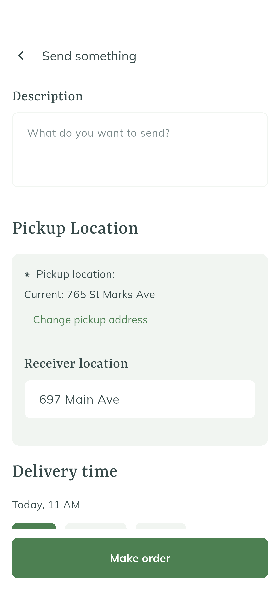
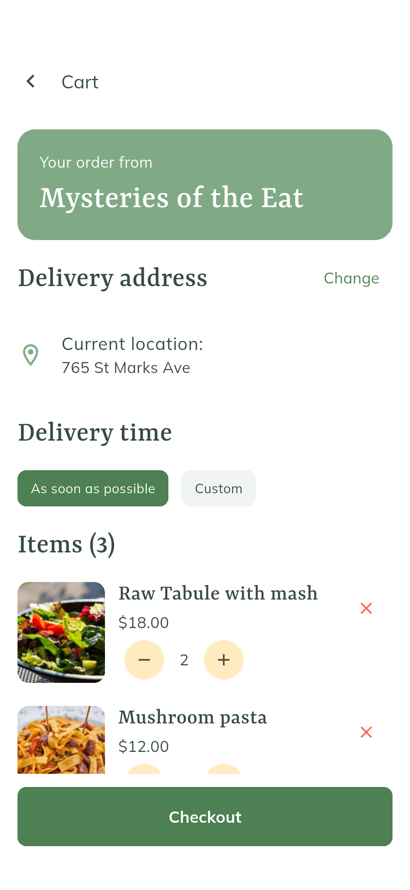
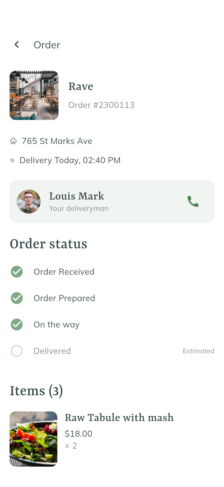
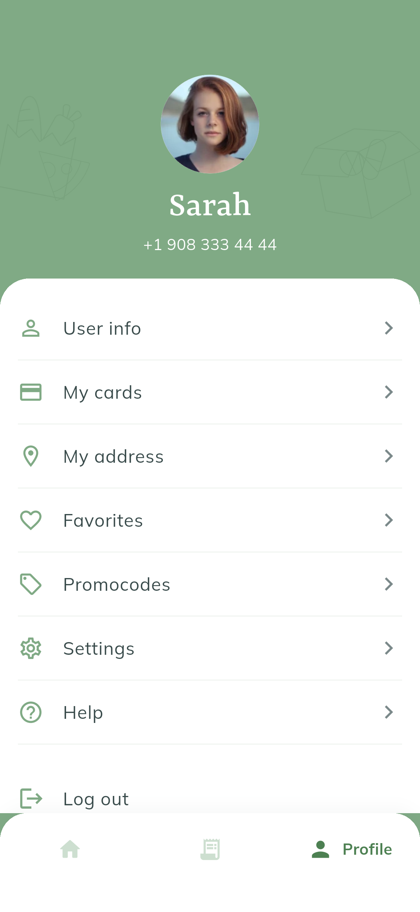
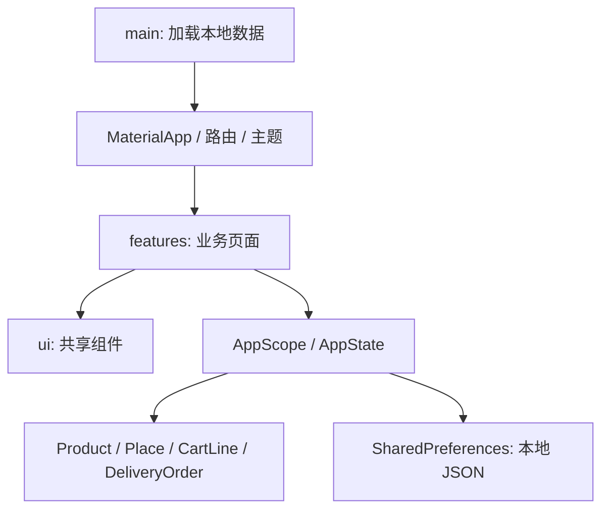

# DeliWell · Flutter 同城配送 App

根据 Pixso 当前打开的 **UI Kit_DeliWell** 实现。读取了 `Page 1` 中的 **41 个界面状态**，并检查 `Symbols` 组件页。项目包含 Flutter 源码、Android 安装包、原稿导出、实际运行截图和自动化测试。

这是可运行、可交互的本地演示应用。短信、支付、库存、配送跟踪尚未连接真实服务。

## 主要界面

以下图片来自 Android 模拟器中的 Flutter 实际渲染；完整截图与原稿逐项对照见 [页面清单](docs/页面清单.md)。长页面另外提供 `_scrolled.png` 截图。

| 首页分类 | 商家详情 | 快递下单 |
| --- | --- | --- |
|  |  |  |

| 购物车 | 配送订单 | 个人中心 |
| --- | --- | --- |
|  |  |  |

## 功能与页面范围

| 模块 | 已实现内容 |
| --- | --- |
| 账户与引导 | 启动页、注册、手机登录、验证码空/填写状态、3 页引导、登录状态保存 |
| 首页 | 6 个分类入口、搜索入口、收货地址、购物车、底部三栏导航 |
| 商家浏览 | 商家搜索、距离/评分/热度排序、菜系多选、饮食偏好多选、筛选重置与实际结果过滤 |
| 商家详情 | 餐厅、超市、优惠展示、分类入口、菜单导航弹层、自定义采购清单 |
| 商品详情 | 普通商品、称重商品、菜品、可展开加料、备注、数量、收藏、价格联动 |
| 购物车 | 增减与移除商品、空状态、地址修改、配送时间、演示支付方式、优惠码、动态小计与总价 |
| 快递配送 | 包裹说明、取件/收件地址、联系电话、今天/明天/自定义时间、包装尺寸、费用与订单生成 |
| 订单 | 当前/预约/历史列表、详情、配送阶段、商品明细、费用、取消预约订单 |
| 个人中心 | 资料查看/编辑、邮箱/手机校验、卡片列表/新增、收货地址、优惠码、设置、帮助、退出与本地账户移除 |
| 收藏 | 商品/收藏箱切换、分类/商家筛选、取消收藏、收藏箱明细、一键再次购买、删除收藏箱 |

原稿的重复空白、填写、展开、筛选状态使用同一页面组件驱动，没有为每张设计稿复制整页代码。药品、鲜花、美妆等分类在原稿中只有首页入口，没有独立商品稿，当前提供配送请求入口。不同餐厅复用演示菜单；真实多商家库存、分单与计费留待后端接入。

## 运行与体验

开发验证环境：Flutter **3.47.7**、Dart **3.13.5**、Android **15 / API 35**。项目提供 Android、iOS、Web 平台目录；iOS 构建需要 macOS 与 Xcode，本次没有在 iOS 上运行验证。

```powershell
flutter pub get
flutter devices
flutter run -d emulator-5554
```

也可以运行 Web 预览：

```powershell
flutter run -d chrome
```

首次启动进入登录，填写至少 7 位数字的联系电话，验证码为 **1234**；完成引导后进入首页。普通启动的购物车为空，截图测试单独注入示例商品，不会更改应用保存的数据。

- 优惠码：**DELI10**，商品金额减免 10%，运费不参与折扣。
- 演示卡号：**4242 4242 4242 4242**；有效期填写未来的 `MM/YY`，CVV 填写 3–4 位数字。
- 卡片仅保存品牌和后四位，完整卡号与 CVV 不写入本地存储。
- 订单与资料保存在本机，关闭重开后保留。退出登录保留本地资料；移除本地账户需要确认。
- 自定义采购清单价格等待商家确认，页面明确说明当前总价仅含运费及已知价格的商品。

## 项目结构与架构

```text
Delivery/
├─ lib/
│  ├─ main.dart                  # 加载本地状态、系统栏、启动
│  ├─ app.dart                   # MaterialApp、主题、统一命名路由
│  ├─ data/
│  │  ├─ catalog.dart            # 商品/商家模型、演示数据、金额格式
│  │  └─ app_state.dart          # 购物车/订单模型、业务操作、本地保存
│  ├─ ui/
│  │  ├─ theme.dart              # 配色、字体、表单、按钮主题
│  │  └─ widgets.dart            # 页面容器、导航、标签、计数器等共享组件
│  └─ features/
│     ├─ auth.dart               # 启动、注册、登录、验证、引导
│     ├─ home.dart               # 首页、分类卡片
│     ├─ catalog.dart            # 商家列表/筛选、商家详情、商品列表
│     ├─ product.dart            # 商品详情、加料、商品行
│     ├─ checkout.dart           # 购物车、配送表单、日期选择
│     ├─ orders.dart             # 订单列表与详情
│     ├─ profile.dart            # 资料、卡片、地址、设置与帮助
│     └─ favorites.dart          # 收藏商品与收藏箱
├─ assets/
│  ├─ images/                    # 从 Pixso 节点提取的 WebP 图像
│  └─ fonts/                     # Yrsa / Mulish 静态字体及 OFL 授权
├─ test/
│  ├─ app_test.dart              # 金额、购物项快照、本地保存等业务测试
│  └─ support/                   # 页面状态清单、复用的交互测试
├─ integration_test/            # Android 页面巡检、截图与交互测试
├─ test_driver/                 # 将设备截图写入 docs/screenshots
├─ docs/
│  ├─ 页面清单.md                 # 原稿、入口、截图对应关系
│  ├─ 验证记录.md                 # 测试环境与最终结果
│  ├─ reference/                 # 41 张原稿、节点/文字/素材清单
│  └─ screenshots/               # 运行截图与总览图
├─ tools/                       # 资源处理与文档索引脚本
├─ releases/                    # Android 安装包
├─ android/ ios/ web/           # 平台工程
└─ pubspec.yaml / pubspec.lock  # 依赖与版本锁定
```

采用 **按功能组织页面 + 共享状态 + 数据层** 的轻量架构。页面负责布局和表单临时状态，跨页面数据由 `AppState` 集中维护，`AppScope` 通过 `InheritedNotifier` 通知界面更新。数据模型与金额计算不依赖页面组件；持久化统一位于 `load()` / `save()`。



购物金额以**整数美分**保存，称重数量保留一位小数，汇总后四舍五入；下单复制购物项快照后清空购物车，后续修改不会影响已有订单。筛选与加料等短期界面状态使用页面内部 `State`，没有为简单交互引入额外状态管理库。

连接真实后端时，可优先将 `AppState` 中的认证、目录、下单和保存操作移入各自的 repository/service，保留现有页面和模型；支付应改为服务商令牌，配送进度改由接口返回。当前没有服务器地址、密钥或实际交易逻辑。

## 设计对应与精简

- 保留原稿英文文案、绿色/奶黄色、衬线标题和图片分类布局。
- 标题使用 Yrsa；原稿 Muli 正文使用其后续字体 Mulish。字体离线打包，运行时无需下载。
- 照片、Logo、装饰图案来自原稿独立节点；页面由 Flutter 控件组成，没有把整张设计截图铺成界面。
- 公共页面容器、输入框、按钮、标签、价格行、计数器、底部栏与商品行统一复用。
- 43 张图像转换为 WebP，约 **18.3 MB → 1.8 MB**；字体实例化为实际使用的静态字重，删除未使用资源与模板占位代码。
- 原稿部分商品单价、数量和汇总互相矛盾，应用按统一数据源重新计算；旧日期改为可选的未来配送时间；原稿错字做了少量修正。
- Android 使用原生系统栏，长稿改为可滚动布局，按钮保持可触达；截图因此不保证和 iOS 风格原稿逐像素相同。

## 测试与重新生成截图

```powershell
flutter analyze
flutter test
flutter drive -d emulator-5554 --driver=test_driver/screenshots.dart --target=integration_test/screenshots_test.dart
```

截图测试独立创建内存中的演示状态，包含 47 个页面/状态和 9 张长页滚动截图。设备交互测试覆盖购买结账、验证码与引导、添加演示卡片、独立删除收藏箱。详细结果见 [验证记录](docs/验证记录.md)。截图流程依据 [Flutter 官方集成测试说明](https://docs.flutter.dev/testing/integration-tests) 实现。

文档总览图与页面索引可在安装 Pillow 后运行 `python tools/build_docs.py` 重新生成。`tools/prepare_assets.py` 用于重新导出 PNG 后转换 WebP，并更新各平台启动图标；这些工具不属于应用运行依赖。

构建 Android：

```powershell
flutter build apk --release --split-per-abi --target-platform android-arm64,android-x64
```

当前安装包用于本地验收，使用开发签名。正式发布需设置自有签名、真实认证/支付/配送服务、服务端校验及隐私相关页面，并重新执行目标平台测试。
