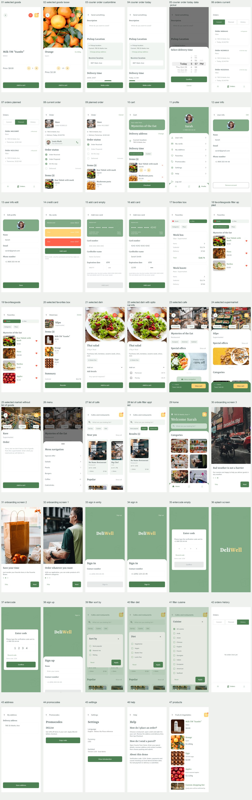

# 页面与截图清单

来源：Pixso `UI Kit_DeliWell` → `Page 1`；`Symbols` 为共享组件库，不作为独立业务页面。

编号与原稿导出保持一致。空白/填写/展开/弹层是同一页面的不同状态；截图测试通过构造参数呈现状态，正常应用中通过按钮、输入和筛选操作进入。

截图由 Android 模拟器中的 Flutter 渲染表面直接导出，不包含 Android 系统状态栏。截图不修改本地保存的数据。

| 编号 | Pixso 原稿名称 | 原稿节点 | 页面路由 | 设计稿 | 运行截图 |
| --- | --- | --- | --- | --- | --- |
| 01 | Selected goods | `0:2` | `/goods` | [原稿](reference/01_selected_goods.png) | [截图](screenshots/01_selected_goods.png) |
| 02 | Selected goods loose | `0:24` | `/goods` | [原稿](reference/02_selected_goods_loose.png) | [截图](screenshots/02_selected_goods_loose.png) |
| 03 | courier_order customtime | `0:46` | `/courier` | [原稿](reference/03_courier_order_customtime.png) | [截图](screenshots/03_courier_order_customtime.png) |
| 04 | courier_order_today | `0:82` | `/courier` | [原稿](reference/04_courier_order_today.png) | [截图](screenshots/04_courier_order_today.png) |
| 05 | courier_order_today data picker | `0:118` | `/courier` | [原稿](reference/05_courier_order_today_data_picker.png) | [截图](screenshots/05_courier_order_today_data_picker.png) |
| 06 | orders current | `0:160` | `/orders` | [原稿](reference/06_orders_current.png) | [截图](screenshots/06_orders_current.png) |
| 07 | orders planned | `0:170` | `/orders` | [原稿](reference/07_orders_planned.png) | [截图](screenshots/07_orders_planned.png) |
| 08 | current order | `0:180` | `/order` | [原稿](reference/08_current_order.png) | [截图](screenshots/08_current_order.png) |
| 09 | planned order | `0:208` | `/order` | [原稿](reference/09_planned_order.png) | [截图](screenshots/09_planned_order.png) |
| 10 | cart | `0:236` | `/cart` | [原稿](reference/10_cart.png) | [截图](screenshots/10_cart.png) |
| 11 | Profile | `0:282` | `/profile` | [原稿](reference/11_profile.png) | [截图](screenshots/11_profile.png) |
| 12 | user info | `0:308` | `/user` | [原稿](reference/12_user_info.png) | [截图](screenshots/12_user_info.png) |
| 13 | user info edit | `0:331` | `/edit-profile` | [原稿](reference/13_user_info_edit.png) | [截图](screenshots/13_user_info_edit.png) |
| 14 | credit card | `0:353` | `/cards` | [原稿](reference/14_credit_card.png) | [截图](screenshots/14_credit_card.png) |
| 15 | add card empty | `0:363` | `/add-card` | [原稿](reference/15_add_card_empty.png) | [截图](screenshots/15_add_card_empty.png) |
| 16 | add card | `0:382` | `/add-card` | [原稿](reference/16_add_card.png) | [截图](screenshots/16_add_card.png) |
| 17 | favorites box | `0:401` | `/favorites` | [原稿](reference/17_favorites_box.png) | [截图](screenshots/17_favorites_box.png) |
| 18 | favoritesgoods filter appled | `0:411` | `/favorites` | [原稿](reference/18_favoritesgoods_filter_appled.png) | [截图](screenshots/18_favoritesgoods_filter_appled.png) |
| 19 | favoritesgoods | `0:432` | `/favorites` | [原稿](reference/19_favoritesgoods.png) | [截图](screenshots/19_favoritesgoods.png) |
| 20 | selected favorites box | `0:453` | `/box` | [原稿](reference/20_selected_favorites_box.png) | [截图](screenshots/20_selected_favorites_box.png) |
| 21 | selected dish | `0:476` | `/dish` | [原稿](reference/21_selected_dish.png) | [截图](screenshots/21_selected_dish.png) |
| 22 | selected dish with optional info | `0:505` | `/dish` | [原稿](reference/22_selected_dish_with_optional_info.png) | [截图](screenshots/22_selected_dish_with_optional_info.png) |
| 23 | selected cafe | `0:540` | `/cafe` | [原稿](reference/23_selected_cafe.png) | [截图](screenshots/23_selected_cafe.png) |
| 24 | selected supermarket | `0:580` | `/supermarket` | [原稿](reference/24_selected_supermarket.png) | [截图](screenshots/24_selected_supermarket.png) |
| 25 | selected market without list of goods | `0:619` | `/market` | [原稿](reference/25_selected_market_without_list_of_goods.png) | [截图](screenshots/25_selected_market_without_list_of_goods.png) |
| 26 | menu | `0:641` | `/cafe` | [原稿](reference/26_menu.png) | [截图](screenshots/26_menu.png) |
| 27 | list of cafe | `0:693` | `/cafes` | [原稿](reference/27_list_of_cafe.png) | [截图](screenshots/27_list_of_cafe.png) |
| 28 | list of cafe filter applied | `25:6123` | `/cafes` | [原稿](reference/28_list_of_cafe_filter_applied.png) | [截图](screenshots/28_list_of_cafe_filter_applied.png) |
| 29 | home | `0:838` | `/home` | [原稿](reference/29_home.png) | [截图](screenshots/29_home.png) |
| 30 | onboarding screen #3 | `0:862` | `/onboarding` | [原稿](reference/30_onboarding_screen_3.png) | [截图](screenshots/30_onboarding_screen_3.png) |
| 31 | onboarding screen #2 | `0:875` | `/onboarding` | [原稿](reference/31_onboarding_screen_2.png) | [截图](screenshots/31_onboarding_screen_2.png) |
| 32 | onboarding screen #1 | `0:888` | `/onboarding` | [原稿](reference/32_onboarding_screen_1.png) | [截图](screenshots/32_onboarding_screen_1.png) |
| 33 | sign in emty | `0:901` | `/sign-in` | [原稿](reference/33_sign_in_emty.png) | [截图](screenshots/33_sign_in_emty.png) |
| 34 | sign in | `0:918` | `/sign-in` | [原稿](reference/34_sign_in.png) | [截图](screenshots/34_sign_in.png) |
| 35 | entercode empty | `0:935` | `/verify` | [原稿](reference/35_entercode_empty.png) | [截图](screenshots/35_entercode_empty.png) |
| 36 | splash screen | `0:957` | `启动` | [原稿](reference/36_splash_screen.png) | [截图](screenshots/36_splash_screen.png) |
| 37 | entercode | `0:975` | `/verify` | [原稿](reference/37_entercode.png) | [截图](screenshots/37_entercode.png) |
| 38 | sign up | `0:997` | `/sign-up` | [原稿](reference/38_sign_up.png) | [截图](screenshots/38_sign_up.png) |
| 39 | filter sort by | `25:7388` | `/cafes` | [原稿](reference/39_filter_sort_by.png) | [截图](screenshots/39_filter_sort_by.png) |
| 40 | filter diet | `25:7670` | `/cafes` | [原稿](reference/40_filter_diet.png) | [截图](screenshots/40_filter_diet.png) |
| 41 | filter cuisine | `25:7957` | `/cafes` | [原稿](reference/41_filter_cuisine.png) | [截图](screenshots/41_filter_cuisine.png) |

## 补充页面

| 页面 | 路由 | 截图 |
| --- | --- | --- |
| 历史订单 | `/orders` | [截图](screenshots/42_orders_history.png) |
| 地址编辑 | `/address` | [截图](screenshots/43_address.png) |
| 优惠码 | `/promos` | [截图](screenshots/44_promocodes.png) |
| 设置 | `/settings` | [截图](screenshots/45_settings.png) |
| 帮助 | `/help` | [截图](screenshots/46_help.png) |
| 商品列表 | `/products` | [截图](screenshots/47_products.png) |

## 长页面补充截图

- [03_courier_order_customtime_scrolled](screenshots/03_courier_order_customtime_scrolled.png)
- [04_courier_order_today_scrolled](screenshots/04_courier_order_today_scrolled.png)
- [08_current_order_scrolled](screenshots/08_current_order_scrolled.png)
- [09_planned_order_scrolled](screenshots/09_planned_order_scrolled.png)
- [10_cart_scrolled](screenshots/10_cart_scrolled.png)
- [22_selected_dish_with_optional_info_scrolled](screenshots/22_selected_dish_with_optional_info_scrolled.png)
- [23_selected_cafe_scrolled](screenshots/23_selected_cafe_scrolled.png)
- [24_selected_supermarket_scrolled](screenshots/24_selected_supermarket_scrolled.png)
- [27_list_of_cafe_scrolled](screenshots/27_list_of_cafe_scrolled.png)

## 全部界面总览

原稿节点与文字结构保存在 `reference/frames.json`、`reference/design-content.json`；素材节点保存在 `reference/assets.json`。
未修改 Pixso 原文件。
